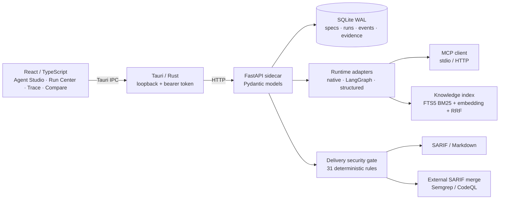
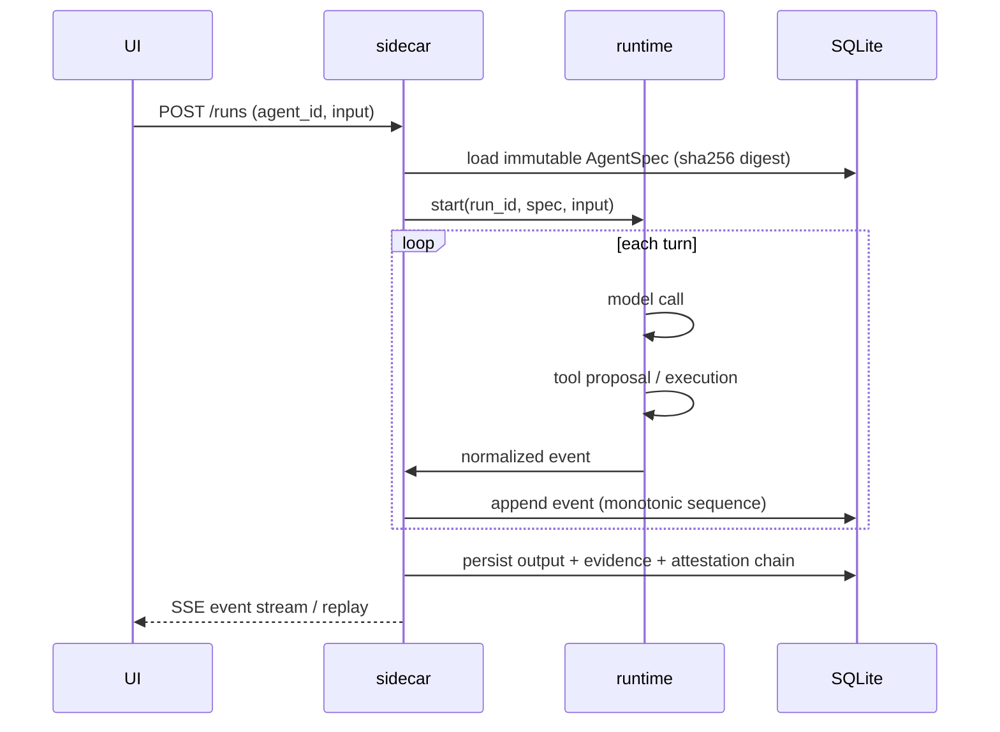
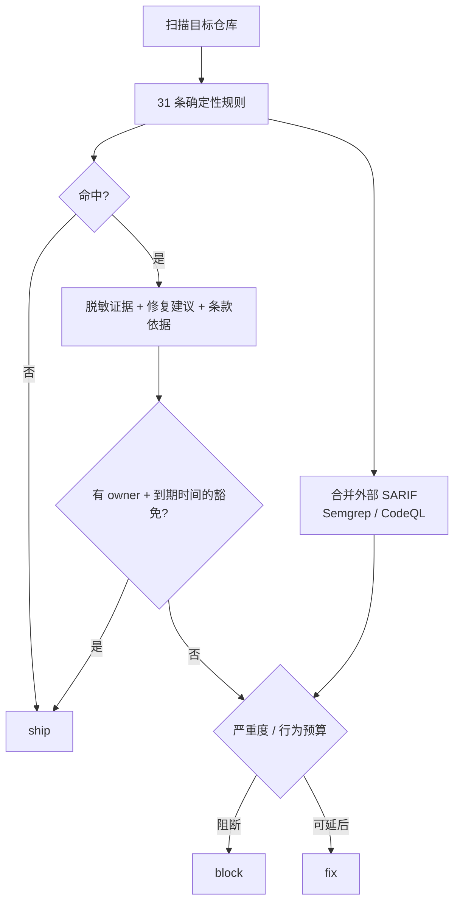

# Agent Crossbar 架构

本文只描述当前代码里真实存在的组件与数据流；边界与未完成项见
[`docs/verification/release-readiness.md`](verification/release-readiness.md)。

## 1. 组件图



- 桌面端不直接访问数据库或模型；所有写操作经过 sidecar。
- sidecar 只绑定 `127.0.0.1`，每次启动生成随机 bearer token，Tauri 侧持有并注入。
- 模型 Key 存 Windows Credential Manager，不进入 SQLite、日志或命令行。

## 2. 一次 run 的数据流



关键不变量：

1. **AgentSpec 不可变**：内容规范化后取 `sha256:` digest；同一版本的 run 可复现。
2. **事件只追加**：`run_events` 有单调 sequence；证据链用哈希串联，可校验是否被篡改。
3. **工具输出有上限**：超过上限直接报 `mcp_tool_output_too_large`，不把大对象塞进上下文。
4. **失败可见**：超时、取消、工具异常都转成结构化事件，不静默吞掉。

## 3. 交付安全闸门



- 规则数量以 `backend/agent_crossbar/security/engine/rules.py` 的 `RuleMeta` 为准（当前 31）。
- 基准报告：`docs/verification/security-benchmark.md`；性能报告：`docs/verification/security-performance.md`。
- 它**不是完整 SAST**；只对已支持规则族给出精确率/召回率。

## 4. 代码地图

| 层 | 路径 | 说明 |
| --- | --- | --- |
| 桌面 | `src/` | React/TS 页面与 Tauri bridge |
| Tauri | `src-tauri/src/` | 进程管理、loopback 鉴权、凭据、发布校验 |
| API | `backend/agent_crossbar/api/` | FastAPI 路由、SSE、Trace diff |
| 领域模型 | `backend/agent_crossbar/domain/` | spec、event、trace、attestation、mcp |
| 运行时 | `backend/agent_crossbar/runtime/` | native、LangGraph、MCP client、worker |
| 存储 | `backend/agent_crossbar/storage/` | SQLite WAL、迁移、知识索引 |
| 安全引擎 | `backend/agent_crossbar/security/engine/` | 规则、策略、SARIF、外部合并 |
| 证据 | `docs/verification/` | 测试、基准、性能、发布边界 |

## 5. 复现

```powershell
uv sync
.venv\Scripts\python.exe -m pytest backend/tests -q   # 243 passed
npm run test:run                                      # 65 passed
npm run build
make demo                                             # spec -> run -> security gate -> SARIF
```
